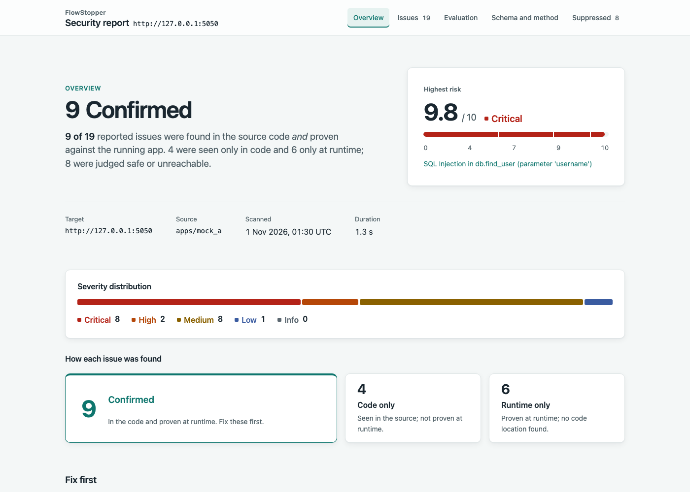
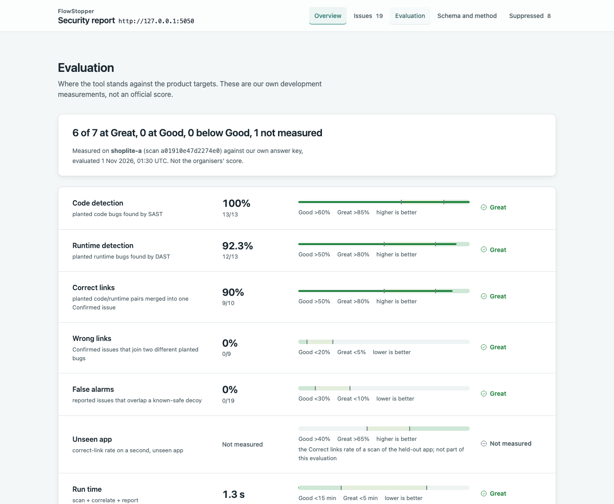

# FlowStopper: SAST + DAST correlation engine

FlowStopper scans a Python web app's **source code** (SAST) and its **running instance** (DAST),
then **correlates** the two, so each real vulnerability appears once. That one entry carries:
- the code line that causes it;
- the URL, parameter and payload that prove it;
- a risk score;
- a fix suggestion.

It supports Flask, FastAPI and Django, and covers SQL injection, XSS, command injection, path
traversal, open redirect and hard-coded secrets, plus passive misconfiguration checks.



## 1. Quick start

You need **Docker** (Docker Desktop or Colima) and **make**. Python is not required for the demo.

```bash
git clone <this-repo> FlowStopper && cd FlowStopper
make demo          # builds the images, starts Mock A, scans it end to end, prints the report path
open out/demo/report.html
make demo-down     # stop Mock A
```

Expected output: 25 routes and 18–19 reported issues, 9 of them Confirmed. One runtime-only
host-wide finding can differ between runs. The run ends with a line like
`Report: /…/FlowStopper/out/demo/report.html`.

> **Colima users:** by default Colima shares only your home directory with containers. Clone the repo
> somewhere under `~`. A clone in `/tmp` fails with `Permission denied: '/app/out/demo'`, because the
> container cannot write to the output folder.

**With Python 3.11+** (for the CLI, the API and the showcase command):

```bash
make setup                     # .venv with the pinned dependencies (requirements-dev.lock)
make check                     # lint + tests (about 770 tests, all offline)
make showcase APP=mock_b       # start a demo target, scan, score, start the API, print every link
make showcase-stop             # stop the target and the API
```

`make showcase APP=…` accepts `mock_a`, `mock_b` or the path of any folder that holds an app's source (see section 2). It prints:
- the report URL and its Evaluation tab;
- the API links: issues, scan status and SARIF;
- the scores, when an answer key exists.

## 2. Scanning the organisers' app

The organisers' source and answer key are confidential and **never committed** (rule R5).
`target_src/` and `keys/` are git-ignored. No answer key is needed to scan: it is only used to score.

**Quickest way: point the showcase command at the folder.** The folder can be anywhere.

```bash
# the app is already running on a local port
make showcase APP=~/Desktop/their_app TARGET=http://127.0.0.1:5000

# the folder has a docker-compose file: it is started and its published port is found automatically
make showcase APP=~/Desktop/their_app

# only if you have a key, or the app needs a login
make showcase APP=~/Desktop/their_app TARGET=http://127.0.0.1:5000 KEY=keys/answer_key.json AUTH=keys/login.json
make showcase-stop             # stop what it started
```

This scans the folder's source (parsed, never run) and the running app, writes the report, and prints
the report and API links. Without `KEY` there are no scores and the Evaluation tab says so. The same
works for the demo apps: `make showcase APP=-MockA`. The manual commands follow.

```bash
mkdir -p target_src keys
cp -R /path/to/their_app/* target_src/
```

**From the host** (the app published on a local port):

```bash
export ALLOWED_HOSTS=localhost,127.0.0.1,::1
.venv/bin/FlowStopper scan --source target_src --target http://127.0.0.1:<port> --out out/target
open out/target/report.html
```

**In Docker**, on the app's own compose network (`docker network ls` shows its name):

```bash
export TARGET_SRC=./target_src TARGET_NETWORK=<their_network> ALLOWED_HOSTS=localhost,127.0.0.1,::1,<service>
docker compose -f docker-compose.yml -f docker-compose.target.yml run --rm --user "$(id -u):$(id -g)" \
  -e FLOWSTOPPER_DB=/app/out/target/.flowstopper/scans.db \
  flowstopper scan --source /src --target http://<service>:<port> --out /app/out/target
```

Useful options on `scan`:

| Option | What it does |
|---|---|
| `--auth-config login.json` | Log in first (static headers/cookies, or a login request whose token is copied onto later requests). Keep the file git-ignored, e.g. in `keys/`. |
| `--fail-on confirmed:high` | CI gate: exit code 2 if a Confirmed issue is high or critical |
| `--key keys/answer_key.json` | Score the scan against an answer key (our format: `docs/ANSWER_KEY_FORMAT.md`); the scores appear on the report's Evaluation tab |

Outputs go into `--out`:
- `issues.json`;
- `scan_meta.json` (per-stage timings, seed, tool versions);
- `report.html`;
- `issues.sarif`;
- `findings.md`;
- `evaluation.json`, when `--key` is given.

## 3. Safety

- **Scope guard (R3):** DAST contacts only hosts in `ALLOWED_HOSTS` (default `localhost,127.0.0.1,::1`).
  - Any other hostname is refused even if it resolves to a private IP. The guard never resolves DNS.
  - It re-checks every redirect hop and refuses non-http(s) schemes.
  - `--allow-host` adds a host and logs a WARNING.
  - Hosts are set by configuration only, never hard-coded in the tool.
- **Harmless payloads only (R4):**
  - Every payload comes from the fixed catalogue in spec Appendix B: canaries, arithmetic echoes, and one read-only `/etc/passwd` probe. A test asserts that nothing else is sent.
  - There are no time-based, destructive or exfiltrating payloads.
  - DELETE is never sent; PUT and PATCH only with `--allow-mutating`.
- **Parse-only SAST (R7):** source is read with Python's `ast` module, never imported or executed.
- **Report hygiene (R7):**
  - All evidence is HTML-escaped, and the report has no scripts and no external assets.
  - `Authorization` and `Cookie` values are redacted unless `--keep-secrets` is set.
  - Login credentials never reach `scan_meta.json` or the database.
  - Hard-coded secrets are masked in the reports.
- **The API binds to 127.0.0.1 by default.** In Docker it is published on `127.0.0.1:8000` only.

## 4. How it works

```
source ─► SAST: file index → routes → call graph → taint (+ summaries) → secrets → templates ─┐
                                                                                             ├─► correlate ─► auto-verify ─► SQLite ─► HTML / SARIF / Markdown / API
running app ─► DAST: scope-guarded client → discovery (seeded by routes + crawl) → checks → verify ─┘
```

- **SAST:**
  - Route extraction for Flask (blueprints, prefixes, factories, `MethodView`, `add_url_rule`, routes registered inside a function), FastAPI (`APIRouter`, `include_router`, pydantic bodies) and Django (`path`, `re_path`, `include`, class-based views).
  - A name-resolved call graph.
  - Taint analysis inside each function, with per-function summaries solved to a fixpoint across the call graph. A finding is reported at the sink, with the HTTP parameter that feeds it (`source_param`) and the routes it can be reached from (`entry_routes`).
  - Sanitisers and guard checks mark safe flows as *suppressed* instead of dropping them.
  - A hard-coded-secrets detector, a Jinja template scan (`|safe`, `autoescape false`), and a check for debug mode left on.
  - Insecure deserialization (`pickle`, `marshal`, unsafe `yaml` loads of request data) is a taint sink too. It is always Code-only, because a safe runtime proof does not exist.
- **DAST:**
  - Endpoints are seeded from the route map, plus a same-origin crawl.
  - Active checks for SQLi, XSS, command injection, path traversal and open redirect.
  - Every hit is re-tested with a second canary plus a benign control, and is reported only if it reproduces.
  - Passive checks for headers, cookies, CORS, verbose errors and version banners.
  - An optional login step.
- **Correlation**, the core: a code finding and a runtime finding become one **Confirmed** issue only when all of the following hold:
  1. **Same CWE family** (e.g. 22/23/36 are one family).
  2. **Route gate (hard):** the runtime finding's route is where the taint flow starts (1.0), the code line is inside that route's handler (0.9), or the code's function is reachable from the handler (0.8). Otherwise they are never linked.
  3. **Score** = `0.50·route + 0.35·param + 0.10·method + 0.05·specificity`. Param is 1.0 when the names match, 0.5 when SAST does not know the parameter, and 0 when they differ.
  4. **One-to-one assignment** of the best pairs scoring at least `0.70`.
  5. **Ambiguity rule:** if two candidates score within `0.10` of each other and the parameter cannot tell them apart, **nothing is linked**. We prefer a missed link over a wrong one.
  6. **Labels:** Confirmed / Code-only / Runtime-only.
  7. **Risk** = CVSS 3.1 base × exploitability factors (×0.85 auth, ×0.9 differential-only proof, ×0.6 code-only, ×0.9 low-confidence runtime-only).

  Each link carries its reasons and their weights, shown in the report. **Auto-verify** then probes each eligible Code-only issue once more with the matching check and upgrades it if the probe proves it.

Details: [`docs/ARCHITECTURE.md`](docs/ARCHITECTURE.md).

## 5. Output formats

| Output | Where |
|---|---|
| **HTML report** | `out/<dir>/report.html`: one offline page with tabs for Overview, Issues (proof first: request and payload, evidence, code line, why it was linked, fix, `curl` repro), Evaluation, Schema and method, and Suppressed |
| **API** | `FlowStopper serve` (or `docker compose up`) on `http://127.0.0.1:8000`: `POST /scans` (202, runs in the background), `GET /scans/{id}`, `GET /issues?scan_id=&label=&cwe=&min_risk=&include_suppressed=`, `GET /issues/{id}`, `GET /scans/{id}/report`, `GET /scans/{id}/sarif`, `GET /health`, interactive docs at `/docs` |
| **SARIF 2.1.0** | `issues.sarif`, for code-scanning tools; validated against the official OASIS schema |
| **Markdown** | `findings.md`, a readable findings list |
| **CLI** | `FlowStopper sast` / `dast` / `correlate` / `scan` / `eval` / `report` / `serve`; `--help` on each |
| **CI gate** | `scan --fail-on confirmed:high` exits **2** when tripped. Exit codes: 0 ok, 1 error, 2 gate, 64 usage error. |



## 6. Results

These are our own measurements against our own answer keys, not an official score. Both mock apps
ran in Docker on this repo's final `main`. The raw numbers are in `docs/metrics/final_mock_a.json`
and `docs/metrics/final_mock_b.json`.

| Target | Code detection | Runtime detection | Correct links | Wrong links | False alarms | Run time |
|---|---|---|---|---|---|---|
| Mock A (our Flask fixture) | 13/13 (100%) | 12/13 (92%) | 9/10 (90%) | 0/9 | 0/19 | 1.3 s |
| **Mock B (held out, FastAPI)** | 13/13 (100%) | 11/14 (79%) | 8/10 (80%) | 0/8 | 0/19 | 1.5 s |

**Unseen app** (spec target >40% good, >65% great): **60%** (6/10). This is Mock B's correct-link
rate at its **first run**, before the tool was ever tuned on it. Two later rounds of generic fixes
took Mock B to 80%. Those later numbers are a tuned result and are not counted as "unseen".

How the results developed:

| Stage | Mock A links | Mock B links | Notes |
|---|---|---|---|
| Phase 3 baseline | 7/10 | (sealed) | `docs/metrics/baseline_mock_a.json` |
| Phase 4 (both developers) | 8/10 | (sealed) | DAST path-parameter injection, command-injection differential, decoy-overlap fix in the scorer |
| Phase 6 first run on Mock B | 9/10 (Docker) | **6/10** | `docs/metrics/mock_b_first_run.json`, frozen |
| Phase 6 rounds 1–2 | 9/10 | 8/10 | FastAPI pydantic bodies, Starlette `TemplateResponse` keywords, traceback check (`docs/metrics/phase6.md`) |

Reading the results:
- **Wrong links are 0 on both apps**, and no decoy raised a false alarm.
- On the Mock A laptop run, as opposed to Docker, runtime detection is 11/13. A traversal bug is missed there because the deep checkout path puts `/etc/passwd` out of reach of the payload's six `../` steps. Docker runs from `/app`.

## 7. Third-party components and AI usage

Every library, with its exact version and licence, and our use of AI coding assistants are disclosed in
[`THIRD_PARTY.md`](THIRD_PARTY.md) (rule R2). Our own work: the whole `FlowStopper/` package, the two
mock apps (`apps/mock_a`, `apps/mock_b`), and all fixtures, tests and scripts.

## 8. Limitations

Honest list: [`docs/LIMITATIONS.md`](docs/LIMITATIONS.md). In short:
- names must resolve statically (no `getattr` dispatch);
- no header/cookie injection in DAST;
- blind injections cannot be proven within the safe-payload rules;
- findings with no route (e.g. in error handlers) are never linked;
- Django support is shallower than Flask and FastAPI.

## Repository layout

| Path | What it holds |
|---|---|
| `FlowStopper/` | the tool (`sast/`, `dast/`, `correlate/`, `report/`, `evalkit/`, `pipeline.py`, `api.py`, `cli.py`) |
| `apps/mock_a`, `apps/mock_b` | our own vulnerable fixture apps, with answer keys |
| `fixtures/` | contract fixtures |
| `docs/` | spec, plan, decisions, metrics |
| `tests/` | test suite |
| `scripts/` | tooling |

The build plan and ownership are in [`docs/PLAN.md`](docs/PLAN.md). Decisions are in `docs/DECISIONS*.md`.
